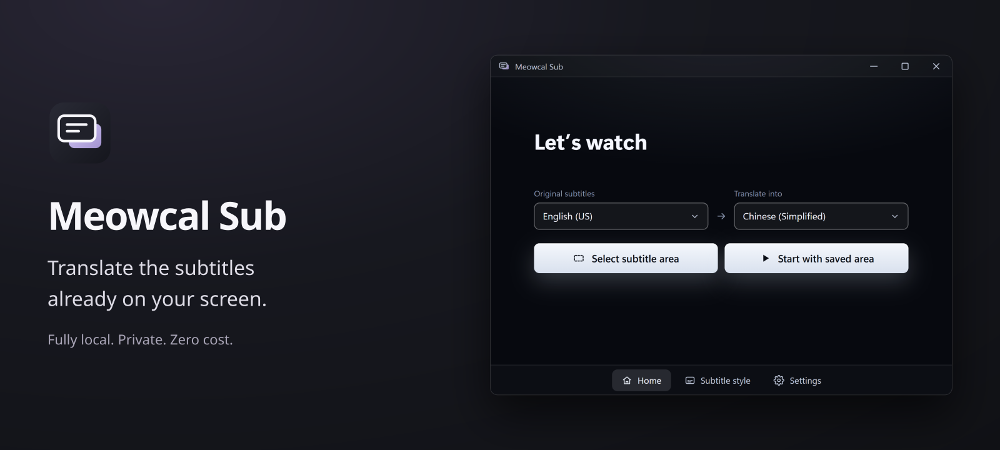
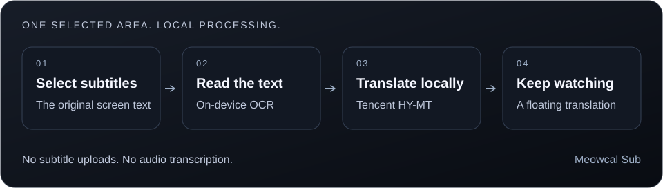
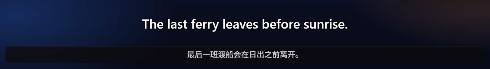

<h1 align="center">Meowcal Sub</h1>

<p align="center">
  <strong>Translate the subtitles already on your screen.</strong><br>
  Local OCR and AI translation for Windows 11. Your subtitle text stays on your PC.
</p>

<p align="center">
  <a href="https://github.com/PeterShanxin/Meowcal-Sub/releases/latest"></a>
  
  <a href="LICENSE"></a>
</p>

<p align="center">
  <a href="#download"><strong>Download for Windows</strong></a>
  &nbsp;·&nbsp; <a href="#quick-start">Quick start</a>
  &nbsp;·&nbsp; <a href="README.zh-CN.md">简体中文</a>
  &nbsp;·&nbsp; <a href="https://github.com/PeterShanxin/Meowcal-Sub/issues/new/choose">Report a problem</a>
</p>

<p align="center">
  
</p>

> **Development preview:** The new branding, bilingual interface, and Home shown above are not yet released. Download links below still point to v0.9.1.

Draw a box around the original subtitles in your video. Meowcal Sub reads that
area, translates the text locally, and puts the translation in a floating
overlay. No subtitle file, cloud account, or API key is needed for normal use.

> **Screen text, not speech.** The video needs visible subtitles. Meowcal Sub
> does not listen to audio or generate captions for a video without on-screen text.

https://github.com/user-attachments/assets/58fbac67-9032-42e2-8d4d-8e4df6c01e59

## Download

**Windows 11 public beta · v0.9.1** — [release notes and all files](https://github.com/PeterShanxin/Meowcal-Sub/releases/tag/v0.9.1).

| Your PC | Installer |
| --- | --- |
| Intel or AMD Windows PC | **[Download x64 (.exe)](https://github.com/PeterShanxin/Meowcal-Sub/releases/download/v0.9.1/Meowcal.Sub_0.9.1_x64-setup.exe)** |
| Snapdragon or other Windows on ARM PC | **[Download ARM64 (.exe)](https://github.com/PeterShanxin/Meowcal-Sub/releases/download/v0.9.1/Meowcal.Sub_0.9.1_arm64-setup.exe)** |

MSI installers and `SHA256SUMS.txt` are on the release page. For newer versions,
use [the latest application release](https://github.com/PeterShanxin/Meowcal-Sub/releases/latest).
You do not need to install Rust, Node.js, or Meowcal Core separately to use the app.

**Engine requirements:** at least **8 GiB of system RAM reported by Windows**
and **3 GiB free on the engine installation drive**. These are setup checks,
not a guarantee of smooth performance; leave headroom for your video player.

First-time setup downloads the local translation runtime and model, about
**1.1 GB**. Allow additional space for caches and retained versions. The
built-in PP-OCRv6 recognizer needs no Windows language. Windows OCR, used for
Korean subtitles or when you choose it, needs the Windows recognition language
for your original subtitles.

**Windows may show an unknown-publisher warning.** Installers are not
Authenticode-signed. Download only from this repository and compare the file's
SHA-256 with the release checksums; do not disable Windows security globally.
[Installation and checksum help →](docs/USAGE.md#installation)

## Quick start

**Bilingual interface, not yet released:** In **Settings → App language**, choose
**System default**, **English**, or **简体中文**. The choice applies immediately
and is saved independently of subtitle languages. Current development builds use
**Select subtitle area** on Home and offer **Start with saved area**. The steps
below use the English labels in the published download. See [App language](docs/USAGE.md#app-language).

1. **Set up translation.** Open the app and complete the guided setup. Choose
   the original subtitle language and the language you want to read; let setup
   install and test the engine.
2. **Start translation.** Move the app window onto the screen playing the
   video and choose **Start translation**. Draw a box around the original
   subtitles, not the whole video, and choose **Confirm and start**. Reselect
   the area when the video moves or changes size.
3. **Watch.** Read the floating translation overlay. Use **Subtitle style** for
   text size and a Dark or Light plate; use **Exit translation** or
   **Stop translation** when you are done.



[Setup, troubleshooting, and frequently asked questions →](docs/USAGE.md)

## Made for watching

<p align="center">
  
</p>

| What you need | What Meowcal Sub does |
| --- | --- |
| Translate visible subtitles without finding a separate subtitle file | Reads the selected screen region with the built-in PP-OCRv6 recognizer, or Windows OCR if you choose it. |
| Keep captured and translated words off cloud services | Runs OCR and Tencent HY-MT translation on your PC. |
| Read the translation without leaving the video | Shows an always-on-top overlay with adjustable text size and a Dark or Light plate. |
| Translate readable text beyond subtitles | **Translate any text** in Settings relaxes the subtitle-only filter. It is off by default. |
| Keep the local engine working | Guided setup, integrity checks, engine repair, and signature-verified in-app updates. |

**Know the limits.** Each session translates one screen: the screen containing
the app when you select the subtitle area. Moving the app during translation
keeps that screen selected. Stop and select again to switch screens. A changed
or disconnected capture screen stops translation and requires a new selection.
Recognition depends on the source language,
text clarity, and what screen capture can actually see. Stylized fonts,
fast-changing text, and protected video can cause missing or incorrect results.
Translation is not instant or error-free; speed depends on your PC and the text.

**GPU support differs by architecture.** ARM64 gates Adreno acceleration to
validated hardware/drivers and can retry on CPU after a GPU readiness timeout.
The x64 build uses Vulkan only on a discrete GPU, runs on CPU otherwise, and can
also retry on CPU after a GPU readiness timeout. If GPU translation misbehaves on either
architecture, choose **Settings → Profile → Compatibility**.
[GPU compatibility details →](docs/USAGE.md#how-does-gpu-support-differ-by-architecture)

## Privacy, without the fine-print surprise

| Stays on your PC | Uses the network |
| --- | --- |
| Capture of the selected region, OCR, translation inference, and the overlay | Engine/model setup or repair downloads, Windows recognition-language installation when needed, and application update checks/downloads |

In normal mode, **captured and translated subtitle text is not uploaded**.
Production logs record support codes, timings, and counts, not subtitle text by default.
The unreleased Local logs setting can opt into Verbose capture images, OCR text,
and translations stored only on this PC, capped at 256 MiB. Treat those files as private.
Once the engine and recognition language are installed, OCR and translation
can run offline; online video playback may still need its own connection.

Update checks run on app startup at most once a day, or when you choose
**Settings → Engine and updates → Check for updates**. An application update is
not downloaded until you start it. Updater signature verification is separate
from Windows publisher signing; it does not remove the installer warning above.

## More Meow tools

Small tools for watching, understanding, and building, each with a focused task.

| Project | Choose it for |
| --- | --- |
| **[Meowcal Sub](https://github.com/PeterShanxin/Meowcal-Sub)** | Direct screen-subtitle capture and local translation — this app. |
| **[Meowcal Sub 2](https://github.com/PeterShanxin/Meowcal-Sub-2)** | Subtitle search and playback-aligned subtitle sessions. |
| **[MeowWatch](https://github.com/PeterShanxin/MeowWatch)** | Watching together with synchronized playback and floating chat. |
| **[Meowcal Core](core/README.md)** | The shared, versioned OCR and local translation runtime for developers; its source lives in this repository. |

Sub 2 is a separate workflow, not a required upgrade for Sub 1. Core is
infrastructure, not another app you need to install manually.

## Under the hood

Tauri 2 and Rust provide the desktop shell. [Meowcal Core](core/README.md) owns
OCR (PP-OCRv6 or Windows OCR) and the managed HY-MT engine; the app owns capture, subtitle
filtering, translation policy, and presentation. Both Windows x64 and ARM64
installers are published here.

See the [architecture](docs/ARCHITECTURE.md),
[Core design decision](docs/adr/0004-versioned-meowcal-core.md), and
[Core performance evidence](docs/CORE_PERFORMANCE.md). Those measurements describe
specific test conditions, not a universal end-to-end subtitle latency guarantee.

## Documentation

| Document | Read it for |
| --- | --- |
| [User guide](docs/USAGE.md) · [Installation](docs/USAGE.md#installation) · [FAQ](docs/USAGE.md#frequently-asked-questions) · [Troubleshooting](docs/USAGE.md#when-something-does-not-look-right) | Settings, what the app is doing, troubleshooting, logs, and safe problem reports |
| [Release notes](docs/releases/) | What each published version changed |
| [Architecture](docs/ARCHITECTURE.md) | Data flow, subtitle queue and timing, recovery, and storage |
| [Contributing](CONTRIBUTING.md) | Building, testing, and proposing changes |
| [Agent guide](docs/AGENT_GUIDE.md) | The working contract, quality bar, and documentation rules |
| [Evaluation](evals/README.md) | Validation layers and measurement method |
| [Meowcal Core](core/README.md) | Core's API and storage contract |

This README and the user guide cover the latest release, v0.9.1, and explicitly
mark unreleased features. Architecture, contributor, and evaluation documents
follow the `main` branch.

## Help and contribute

[Report a bug or suggest an improvement](https://github.com/PeterShanxin/Meowcal-Sub/issues/new/choose).
Include the app version, Windows build, architecture, and a non-private
reproduction. Do not post captured subtitle text, private screenshots, or raw
logs containing them. Report vulnerabilities privately using [SECURITY.md](SECURITY.md).

For development, start with [CONTRIBUTING.md](CONTRIBUTING.md) and the
[agent guide](docs/AGENT_GUIDE.md). From a prepared Windows checkout:

```powershell
.\scripts\verify.ps1
.\dev-tauri.cmd
```

Browser-only development is available through `.\dev-browser.cmd`; it does not
validate native capture, OCR, overlays, or installers. Intentional contributions
are governed by the [CLA](CLA.md).

## License

Community source: **[AGPL-3.0-only](LICENSE)**. See the
[application notice](LICENSE-NOTICE.md). Using the public project under AGPL does
not require a paid license; commercial licensing is available for organizations
that require different terms.

The translation model has separate [license and usage terms](LICENSE-NOTICE.md#separately-downloaded-translation-model).
[Name and logo use](TRADEMARKS.md) is separate too.
