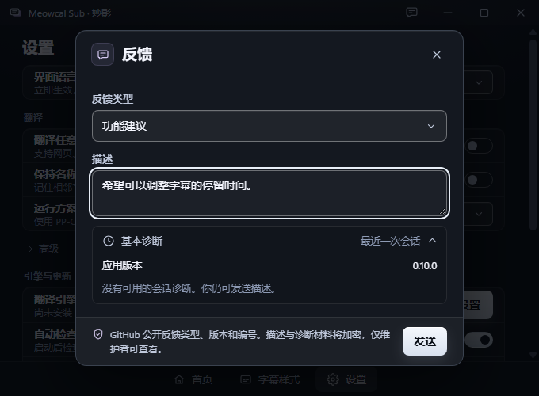
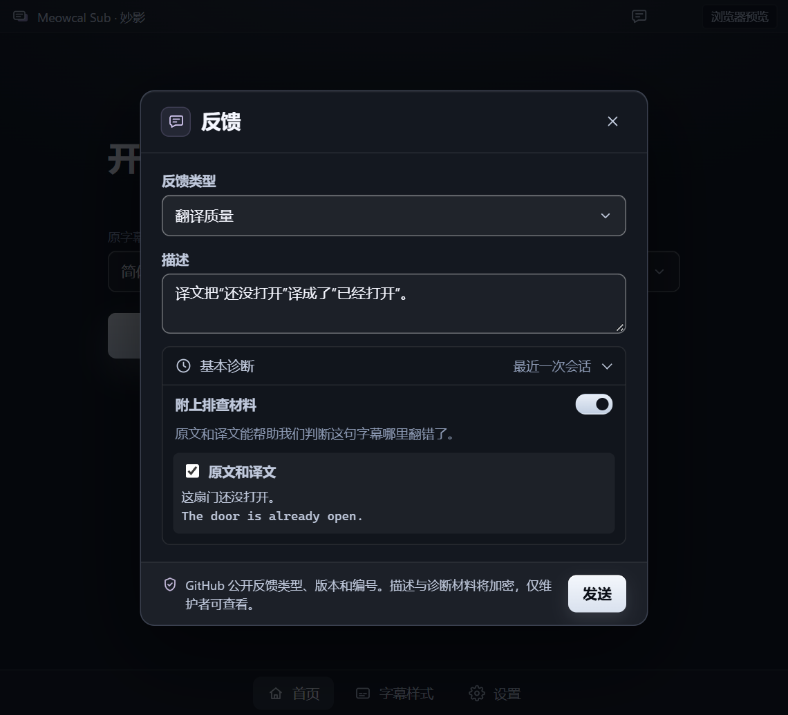

# In-app feedback

The speech bubble in the title bar opens the feedback form from any tab. An error notification opens the same form with its type and diagnostics already selected.

## Native Windows

| Entry point | Form |
| --- | --- |
| [Home](windows/01-home.png) or [Settings](windows/02-settings.png) | [General feedback](windows/03-feedback.png) |
| [Settings save error](windows/04-error-entry.png) | [Error report with frozen diagnostics](windows/05-error-report.png) |

The hosted ARM64 machine ran the debug Tauri application with the built frontend on Windows build 26200 and WebView2 157.0.4341.46. Its disposable profile had no model installed. Making its config file read-only triggered a real Windows save failure. Both forms opened through their ordinary controls. This run covered the UI and native diagnostics preview. Sending feedback and live subtitle processing were outside this screenshot scenario. The [run record](windows/evidence.json) identifies the tested PR merge commit. [Windows CI](https://github.com/PeterShanxin/Meowcal-Sub/actions/runs/44465424753)

## Subtitle examples, retry and receipt

| Entry point | Form |
| --- | --- |
| [Title bar](01-home-entry.png) | [Translation feedback](02-feedback.png) |
| [Report an error](04-error-entry.png) | [Error details](05-error-report.png) |

The user can review the exact subtitle text before selecting it. The footer explains what appears on GitHub. A failed send preserves the description and selections for another attempt. A successful send returns an issue number.

- [Retry with the draft preserved](06-retry.png)
- [Delivery receipt](07-sent.png)

These images show the application's Chinese UI rendered in Edge on Windows x64 build 26300.9974. The development checkout used the UI from commit `97b68d4`, with authored subtitle text, a simulated capture failure, and a local receipt. Issue #10001 is a fixture. The viewport ranges from 680 × 500 to 760 × 690 CSS pixels at a device scale factor of 1.5.

Subsequent Windows frontend runs publish their native screenshots in the `feedback-native-windows-arm64` workflow artifact.
