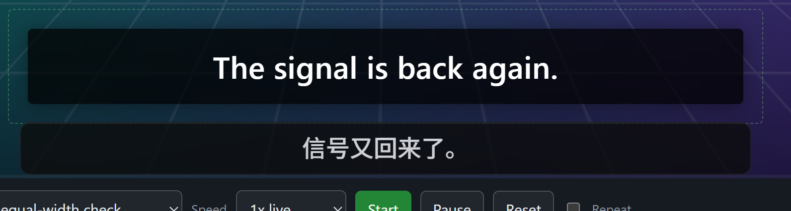
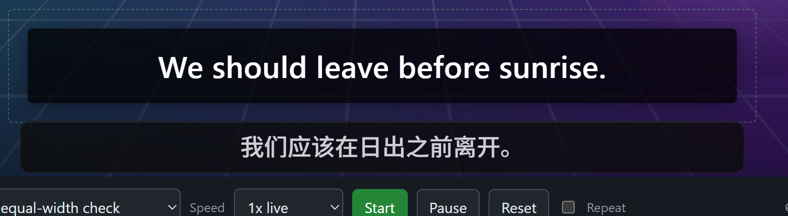

# Multi-monitor Windows validation — 2026-11-08

Native application source: `eb617bf4174347a8a9a38af9cfe243ffc66f50da`.
The subsequent changes affect the offline evaluator and evidence only.
Development executable SHA-256:
`d1ae5d0b94cf514b5204f73bacb44dfeaf3973ea914d2c2ae36ee79446d52f90`.

## Environment

- Windows 11 Pro ARM64, build 26300; native debug development application,
  separate `com.meowcal.sub.dev` identity.
- Pinned Core 0.2.2, PP-OCRv6 and HY-MT, English → Chinese. Context and
  **Translate any text** disabled for scored runs.
- Real displays, both at 120 Hz:

| Display | Physical desktop bounds | DPI scale | Initial role |
| --- | --- | --- | --- |
| EDO4179 internal | `(-3120, 0) 3120 × 2080` | 200% | Secondary |
| SAC2450 external | `(0, 0) 2560 × 1440` | 125% | Primary |

The [authored moving-scene fixture](../../evals/band-gate/README.md) ran in a
native browser window. The development application used real Windows capture,
OCR, translation and native overlay windows. Browser-mode bridge results are
not used as native evidence. Each scored run completed at 1x with Repeat off.

## Cue and exclusion results

Reports retain individual authored cue IDs, coverage and translation timings.
`trueTranslated` requires the matching source and `displayState: translated`.

| Run | OCR / admitted / true translated | Negative / blank admissions after warmup | Translation p95 | Report |
| --- | --- | --- | --- | --- |
| External 125%, equal-width 120 s | 30 / 30 / 30 | 0 / 0 | 1090 ms | [JSON](2026-11-08-multi-monitor/external-valid.json) |
| Internal 200%, equal-width 120 s | 30 / 30 / 30 | 0 / 0 | 1732 ms | [JSON](2026-11-08-multi-monitor/internal-valid.json) |
| External, negative/recovery 120 s | 5 / 5 / 5 | 0 / 0 | 781 ms | [JSON](2026-11-08-multi-monitor/negative.json) |
| Negative/recovery, first run in a continuous capture session | 5 / 5 / 5 | 0 / 0 | 659 ms | [JSON](2026-11-08-multi-monitor/negative-warmup.json) |
| Negative/recovery, second run in that session | 5 / 5 / 5 | 0 / 0 | 618 ms | [JSON](2026-11-08-multi-monitor/negative-warm.json) |

All five reports have `gateOk: true`, `endToEndOk: true`, `partial: false`.
All negative segments have sustained nonempty coverage. The equal-width
selections were approximately 920 × 116 physical pixels externally and
1472 × 186 internally. Negative/recovery used the full multiline subtitle card.
These timings describe the fixture and this machine, not a performance comparison.

Two original negative reports each counted one watermark frame as a failure:
[initial run](2026-11-08-multi-monitor/negative-original.json),
[second continuous-session run](2026-11-08-multi-monitor/negative-warm-original.json).
The recordings exposed two evaluator errors:

- Capture elapsed time was 6055 ms while the filter's observation elapsed time
  was 5997 ms. The evaluator now uses the existing monotonic observation clock
  for the unchanged six-second warmup; capture UTC still assigns authored cues.
- One frame of the preceding dialogue started the next watermark's warmup
  before the watermark was recognized. Warmup and coverage now require the
  authored negative content. Unrelated screen text cannot prove exclusion.

The raw recordings were rescored, without changing application behavior or
filter thresholds. Regression tests fail with the former evaluator, cover
exactly-six-second admission, and reject missing/reset observation clocks and
unrelated text. The original failed reports remain alongside the corrected
ones. Raw text logs remain local.

## Display transitions

| Scenario | Observed result |
| --- | --- |
| Main window straddles displays | Selector follows Windows' monitor choice for the largest window intersection; both sides tested. Native selector bounds and scale match the chosen display. |
| Move Home during translation | At 40 s of the internal equal-width run, Home moved to the external display. Capture and overlay stayed internal; all 30 authored cues completed. Stopping cleared the area shown on the other display. |
| Restart on the bound display | Exact saved identity, geometry and DPI restored the area; translation did not start automatically. |
| Move to a different display before starting | Area becomes unavailable; a direct start is rejected with a request to select on the current display. |
| Change primary display while translating | Internal became primary and external moved to `(3120, 0)`. Translation stopped, overlay hid and area cleared approximately 138 ms after the display API returned. |
| Negative Y origin | Internal moved to `(0, -2080)` at 200%. New selection, correct source, Chinese translation and overlay bounds all matched that display. |
| Detach active capture display | Windows removed the internal display from the desktop. Translation stopped and area cleared approximately 75 ms after the API returned; no fallback to the surviving display. |
| Restart with the display absent | Single-display UI, no restored area and no automatic translation. |
| Reconnect | Multi-display hint returned; area remained unset and translation remained stopped. Reselecting produced the new source “Keep the door closed.” and its Chinese translation. |
| Overlay pointer routing | Real Windows clicks opened the style menu on both displays: negative-X 200% at `(-1332, 1214)` and 125% at `(1424, 693)`. Hit windows were verified as owned by the test application. |

Primary changes, negative-Y positioning and output detachment used documented
Windows display configuration APIs, with bounded rollback. No driver or device
was disabled. This tests actual desktop topology removal and reconnection;
physical cable removal was not performed. Live DPI-setting changes and native
x64 graphics hardware were not exercised; geometry/DPI invalidation has
automated coverage and both native architectures run in CI.

## Native screenshots

Internal 200% with a negative X origin, final authored cue and Chinese overlay:

Internal 200% above the primary display, with a negative Y origin:

## Cleanup and automated checks

Original display modes, user window placement, pointer position and all four
production/development configuration files were restored. Configuration hashes
matched their backups. Task-owned app, browser, fixture and child processes
exited; all temporary power requests were released. The production application
was not installed or replaced.

At the native application source commit, `scripts/verify.ps1 -Stage All`
passed: Core 119 unit + 16 executable/service contracts; application 576 unit,
16 IPC and 3 command contracts; 555 frontend and 35 browser tests. Production
Clippy, formatting, TypeScript, documentation, maintainability and dependency
audit passed. The evaluator regression suite has 20 passing tests.
